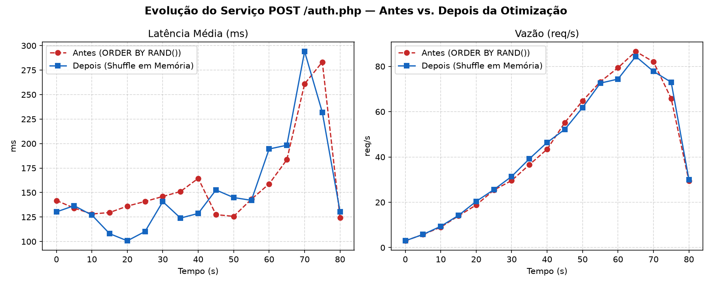

## MEDIÇÕES DO SLA

### Serviço 1: Consulta de Cartas (`GET /cartas.php`)
* **Tipo de operações:** Leitura
* **Arquivos envolvidos:**
  * [`backend/cartas.php`](./backend/cartas.php)
  * [`backend/config.php`](./backend/config.php)
* **Arquivos com o código fonte de medição do SLA:**
  * [`testes/sla/teste_cartas.js`](./testes/sla/teste_cartas.js) *(ajustar nome se corresponder a outro arquivo na pasta)*
  * [`testes/sla/gerar_graficos_evolutivos.py`](./testes/sla/gerar_graficos_evolutivos.py)
* **Descrição das configurações:** Ambiente local em máquina Windows com Apache, PHP e MySQL em `localhost`, testes de carga com Grafana k6 e geração de gráficos com Python (`pandas` e `matplotlib`).

#### MEDIÇÃO 1
* **Data da medição:** `[DD/MM/AAAA]`
* **Testes de carga (SLA):**
  * **Latência:** `[Preencher valor medido do Serviço 1]`
  * **Vazão:** `[Preencher req/s medido do Serviço 1]`
  * **Concorrência (limite de requisições simultâneas):** `[Preencher VUs / limite medido]`
* **Potenciais gargalos do sistema:** `[Preencher gargalos observados no Serviço 1]`

#### MEDIÇÃO 2
* **Data da medição:** `[DD/MM/AAAA]`
* **Testes de carga (SLA):**
  * **Latência:** `[Preencher se houver 2ª medição do Serviço 1]`
  * **Vazão:** `[Preencher se houver 2ª medição do Serviço 1]`
  * **Concorrência (limite de requisições simultâneas):** `[Preencher se houver 2ª medição do Serviço 1]`

#### GRÁFICOS comparativos das medições feitas
* `[Inserir caminho do gráfico comparativo do Serviço 1, se houver]`

#### Melhorias/otimizações
* `[Listar arquivos modificados no Serviço 1, se houver]`

---

### Serviço 2: Cadastro de Usuário e Sorteio Inicial de Cartas (`POST /auth.php`)
* **Tipo de operações:** Leitura e inserção (transacional)
* **Arquivos envolvidos:**
  * [`backend/auth.php`](./backend/auth.php)
  * [`backend/config.php`](./backend/config.php)
* **Arquivos com o código fonte de medição do SLA:**
  * [`testes/sla/teste_cadastro.js`](./testes/sla/teste_cadastro.js)
  * [`testes/sla/gerar_graficos_evolutivos.py`](./testes/sla/gerar_graficos_evolutivos.py)
* **Descrição das configurações:** Ambiente local em máquina Windows com Apache, PHP e MySQL em `localhost`, carga executada via Grafana k6 (`resultado_cadastro_antes.json` e `resultado_cadastro_depois.json`) e gráficos gerados em Python.

#### MEDIÇÃO 1
* **Data da medição:** `[DD/MM/AAAA]`
* **Testes de carga (SLA):**
  * **Latência:** Média de **157,63 ms**
  * **Vazão:** Média de **42,47 req/s**
  * **Concorrência (limite de requisições simultâneas):** `[Preencher VUs / limite medido]`
* **Potenciais gargalos do sistema:** Uso de `ORDER BY RAND() LIMIT 4` na consulta das cartas iniciais no MySQL (ordenação aleatória com custo extra de CPU/processamento no banco), além do custo de `password_hash()` e gravações na transação do cadastro.

#### MEDIÇÃO 2
* **Data da medição:** `[DD/MM/AAAA]`
* **Testes de carga (SLA):**
  * **Latência:** Média de **152,66 ms** (redução de **4,97 ms** / **-3,15%** em relação à Medição 1)
  * **Vazão:** Média de **42,45 req/s** (variação de **-0,02 req/s** / **-0,05%** em relação à Medição 1)
  * **Concorrência (limite de requisições simultâneas):** `[Preencher VUs / limite medido]`

#### GRÁFICOS comparativos das medições feitas

#### Melhorias/otimizações
* [`backend/auth.php`](./backend/auth.php) — Substituição do `ORDER BY RAND() LIMIT 4` pela busca dos IDs disponíveis (`SELECT PK_id_Carta FROM Carta`), embaralhamento em memória no PHP com `shuffle()`, seleção de até 4 IDs e consulta direta com `IN (...)` antes de inserir em `Carta_Usuario`.
* [`testes/sla/gerar_graficos_evolutivos.py`](./testes/sla/gerar_graficos_evolutivos.py) — Script criado para comparar as métricas das medições antes e depois da otimização e gerar o gráfico evolutivo.