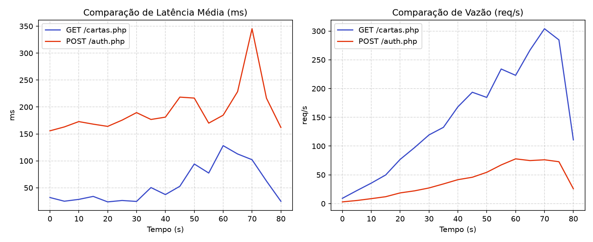
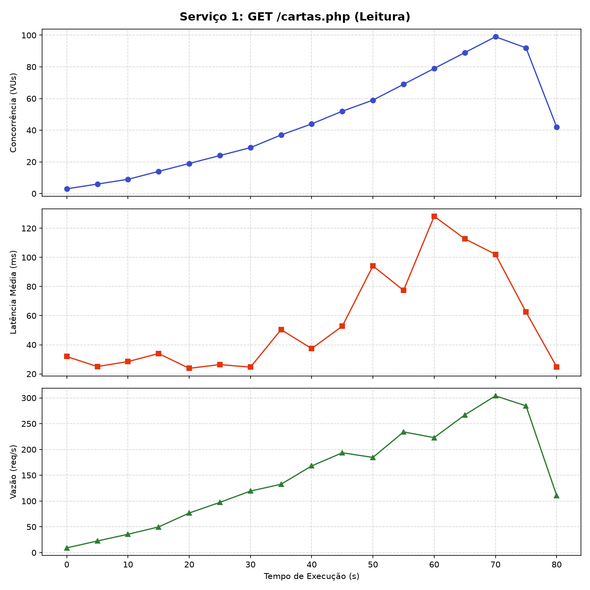
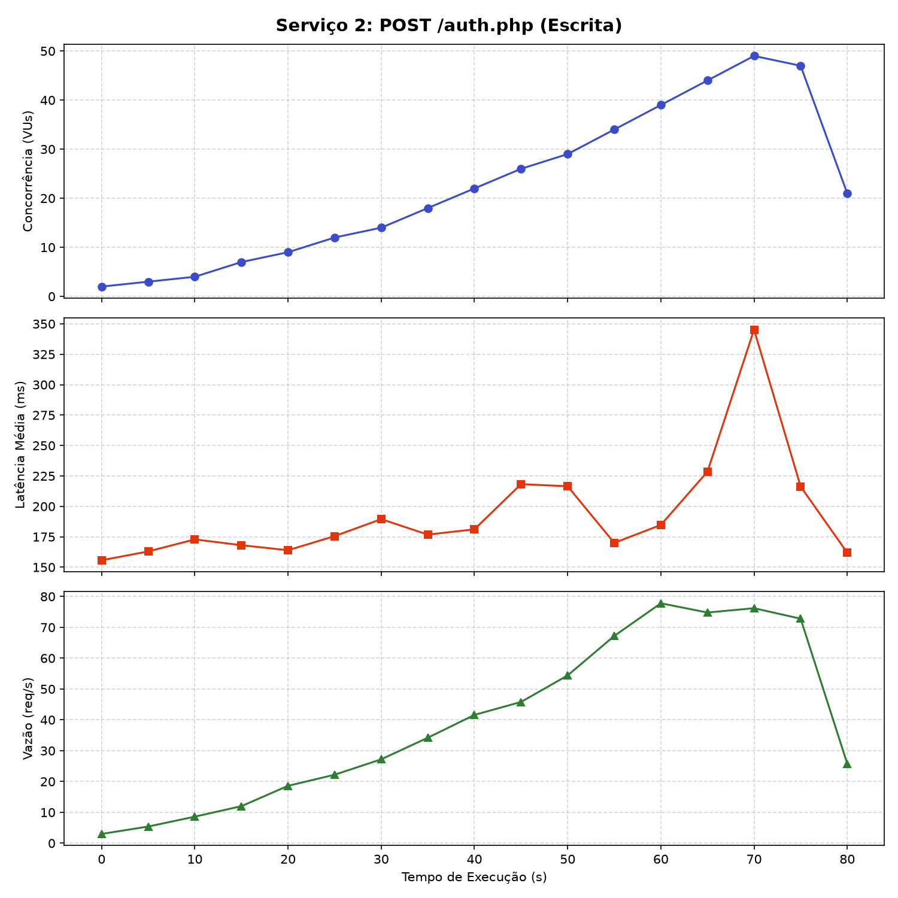

# RELATÓRIO DE SLA E TESTES DE CARGA — JoQuemMon

## Visão Comparativa Geral

---

## 1. Serviço 1: Listagem de Cartas do Inventário (`GET /cartas.php`)
* **Tipo de operações:** Leitura (`SELECT`)
* **Arquivos envolvidos:**
  * [`backend/cartas.php`](../../backend/cartas.php)
  * [`backend/config.php`](../../backend/config.php)
  * [`src/app/pages/inventario/inventario.component.ts`](../../src/app/pages/inventario/inventario.component.ts)
* **Descrição das configurações:** Ambiente local em sistema Windows, executando servidor Apache 2.4 + PHP 8.2 (via XAMPP) e banco de dados relacional MySQL (InnoDB) na mesma máquina (`localhost`). Testes conduzidos com Grafana k6.

### Testes de Carga (SLA)
* **Latência Média Geral:** ~41.5 ms (Pico máximo de ~128 ms sob 100 VUs).
* **Vazão Média:** ~152 req/s (Pico máximo de ~304 req/s).
* **Concorrência Máxima:** Escalonamento gradual de 3 até 100 usuários virtuais simultâneos (VUs).

### Levantamento de Hipóteses de Gargalos
1. **Custo de Junção (Joins) em Massa:** A query executa múltiplos `JOIN`s entre `Carta`, `Carta_Usuario`, `Carta_Tipo` e `Tipo`, utilizando `GROUP_CONCAT` e `GROUP BY`. Sob 100 VUs simultâneas, o tempo de resposta cresce linearmente devido ao esforço de ordenação do MySQL.
2. **Conexões Simultâneas no Apache:** A ausência de persistência de conexão (*connection pooling*) força a abertura e fechamento constante de sockets TCP e instâncias PDO.

---

## 2. Serviço 2: Cadastro de Treinador com Sorteio (`POST /auth.php`)
* **Tipo de operações:** Leitura e Inserção (`SELECT` + `INSERT` transacional)
* **Arquivos envolvidos:**
  * [`backend/auth.php`](../../backend/auth.php)
  * [`backend/config.php`](../../backend/config.php)
  * [`src/app/pages/cadastro/cadastro.component.ts`](../../src/app/pages/cadastro/cadastro.component.ts)
* **Descrição das configurações:** Mesmo ambiente local Apache/PHP/MySQL em `localhost` com transações ACID isoladas via InnoDB.

### Testes de Carga (SLA)
* **Latência Média Geral:** ~192 ms (Pico crítico de ~345 ms sob carga máxima de 50 VUs).
* **Vazão Média:** ~42 req/s (Teto estabilizado em ~78 req/s).
* **Concorrência Máxima:** Ramp-up controlado de 2 até 50 usuários virtuais simultâneos (VUs).

### Levantamento de Hipóteses de Gargalos
1. **Processamento Intensivo de CPU (`password_hash` / Bcrypt):** O algoritmo de hash de senha consome muitos ciclos de processador para garantir segurança, elevando a latência basal e limitando a vazão máxima de requisições por segundo.
2. **Varredura Randômica no Banco (`ORDER BY RAND()`):** A seleção aleatória das cartas do baralho na batalha acaba atrasando um pouco a resposta.